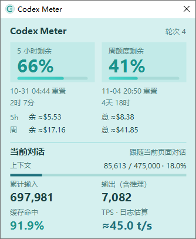
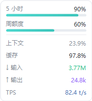

# Codex Meter

轻量 Windows Codex 用量监测工具，提供托盘面板与跟随窗口的白色悬浮窗。

[下载最新版](https://github.com/namixiaoxing/CodexMeter/releases/latest) · [常见问题](TROUBLESHOOTING.md) · [版本说明](CHANGELOG.md)

## 快速上手

1. 安装 [.NET 8 Desktop Runtime x64](https://dotnet.microsoft.com/download/dotnet/8.0)，并登录 Codex 桌面端。
2. 下载 Windows x64 便携包，解压到固定目录。
3. 运行 `dist\CodexMeter.exe`，Codex 窗口就绪后约两秒开始显示。

单击托盘图标查看详情；右键可切换面板大小、主题、悬浮窗和自动跟随。托盘面板与美元详情不占任务栏位置。

## 界面与操作





- **悬浮窗**：固定在输入框右侧、底部对齐。空间充足时显示完整指标，较窄时显示双竖条额度；放不下时隐藏。
- **拖动面板**：在工作区横向拖动时暂时收起悬浮窗，松手后重新定位，减少遮挡。Codex 窗口整体移动仍正常跟随。
- **托盘面板**：支持 67% / 85% / 100% 三档布局，以及白色、黑色、Miku 青绿主题；主题只影响详情面板，悬浮窗保持白色。
- **查看细节**：悬停查看重置时间、精确计数和 TPS 样本说明；美元详情可查看估算区间与校准状态。

截图使用合成数字，仅用于展示布局。

## 指标说明

| 指标 | 含义 |
| --- | --- |
| 5 小时 / 周额度 | 当前账号的剩余比例与重置时间；启动时及每 5 分钟查询，可手动刷新。 |
| 上下文 | 当前对话最近一次模型调用的上下文占用比例；自动压缩后可能下降。 |
| 输入 / 输出 | 当前对话累计 token；输出包含推理 token。`k` 为千，`M` 为百万。 |
| 缓存 | 缓存命中 token 占累计输入的比例，以及累计命中量。 |
| 轮次 | 按唯一执行轮次统计；工具调用和重复记录不重复计数。 |
| TPS | 上一次完整最终回答的正文 token / 输出时间；排除推理和工具，属于日志估算。 |
| 美元估算 | 根据本机 token 的 API 等价成本与额度变化动态校准，分别估算两档额度的总量及剩余量。 |

**TPS 不是实时解码速度**。短回答可能受缓冲影响而偏高；旧样本会保留并标注，缺少可靠样本时显示 `—`。

**美元估算不是官方余额**。仅支持 GPT-6 Astra、GPT-6.1 Sol、GPT-6.1 Terra；样本不足时显示采样中。换号、其他设备消耗或缺失日志都会影响估值，5 小时和周额度不能相加。

当前对话优先按页面标题匹配本机会话。重名、远程会话或尚无本机记录时，可能只显示额度。

## 自动跟随与升级

- 在托盘菜单启用“登录后自动跟随 Codex”，或运行 `scripts\Enable-AutoFollow.ps1`。使用当前用户的计划任务，无需管理员权限。
- Codex 关闭后释放指标监测，仅保留启动监听；再次打开时恢复。选择“完全退出”可结束本次后台运行。
- 升级前完全退出旧版，再替换文件。更换目录后，重新运行启用脚本以更新启动路径。
- 卸载时运行 `scripts\Disable-AutoFollow.ps1`，退出程序后删除解压目录。偏好和校准数据位于 `%LOCALAPPDATA%\CodexMeter`，可按需保留。

## 数据与运行范围

原生 WinForms / .NET 8，共享桌面运行时。仅读取当前用户的 Codex 额度、本机会话数字记录和窗口布局；不保存聊天正文，不直接读取登录凭据，不上传会话数据，无遥测、更新检查或其他服务监测。

程序未签名；Codex 内部日志或接口变化后可能需要适配。发布包采用白名单打包，不包含本机设置、账号缓存或会话日志。

## 从源码构建

需要 .NET 8 SDK，在项目根目录运行：

```powershell
.\scripts\Build.ps1
.\scripts\Package.ps1
```

SDK 不在 PATH 时可添加 `-DotnetPath '<dotnet.exe路径>'`。打包脚本运行回归检查，并在 `artifacts` 生成便携包、源码包和 `SHA256SUMS.txt`。诊断方法见[常见问题](TROUBLESHOOTING.md)。

## 致谢

- [Codex Token Overlay](https://github.com/soleillevant0125/codex-token-overlay)：只读 Desktop IPC 监听器，授权说明见 [THIRD-PARTY-NOTICES.txt](THIRD-PARTY-NOTICES.txt)。
- [CodexBar](https://github.com/steipete/CodexBar)：额度窗口与余额展示方式参考。
